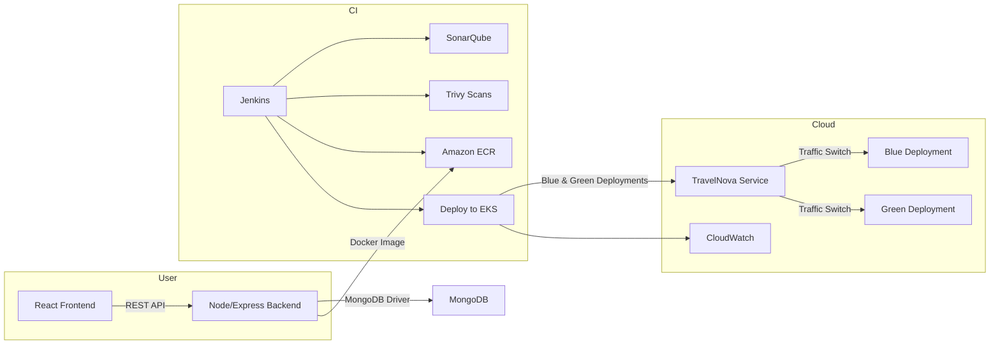

# Secure CI/CD Pipeline for Containerized Applications

## Project: TravelNova – Smart Travel Booking Platform

> A production‑grade, end‑to‑end DevSecOps showcase that includes a three‑tier MERN‑style app, automated CI/CD with Jenkins, SonarQube, Trivy, blue‑green deployments on Amazon EKS, Terraform‑managed infrastructure, and CloudWatch observability.

---

## Table of Contents
1. [Architecture Overview](#architecture-overview)
2. [Repository Structure](#repository-structure)
3. [Local Development & Docker Compose](#local-development--docker-compose)
4. [CI/CD Pipeline (Jenkins)](#cicd-pipeline-jenkins)
5. [Blue‑Green Deployment](#blue-green-deployment)
6. [Security Scanning Workflow](#security-scanning-workflow)
7. [Infrastructure (Terraform)](#infrastructure-terraform)
8. [Kubernetes Manifests](#kubernetes-manifests)
9. [Monitoring & Observability](#monitoring--observability)
10. [Cost & Cleanup](#cost--cleanup)
11. [Screenshots & Visuals](#screenshots--visuals)
12. [License](#license)

---

## Architecture Overview



> **Figure 1** – High‑level system architecture. *(Replace the Mermaid diagram with a rendered SVG in the final repo or keep it as‑is for live preview.)*

---

## Repository Structure

```
secure-cicd-container-platform/
│
├─ frontend/                # React UI
│   ├─ src/                # React components & pages
│   └─ public/             # Static assets (icons, index.html)
│
├─ backend/                 # Express API
│   └─ src/                # Controllers, routes, models
│
├─ database/                # Docker‑Compose MongoDB service definition
│
├─ docker/                  # Multi‑stage Dockerfiles
│   ├─ frontend.Dockerfile
│   └─ backend.Dockerfile
│
├─ kubernetes/              # K8s manifests (blue/green, service, ingress, etc.)
│   ├─ blue/
│   ├─ green/
│   └─ base/
│
├─ terraform/               # IaC modules and environments
│   ├─ modules/
│   └─ environments/
│
├─ scripts/                 # Deploy, switch‑traffic, rollback, health‑check
│
├─ docs/                    # Documentation, diagrams, screenshots
│   └─ screenshots/        # **Capture screenshots here** – see Section 11
│
├─ .gitignore
├─ docker-compose.yml
├─ Jenkinsfile
├─ README.md                # (this file)
└─ LICENSE
```

---

## Local Development & Docker Compose

```yaml
# docker-compose.yml
version: "3.9"
services:
  mongo:
    image: mongo:7
    container_name: travelnova-mongo
    restart: unless-stopped
    volumes:
      - mongo-data:/data/db
    ports:
      - "27017:27017"

  backend:
    build:
      context: ./backend
      dockerfile: ../docker/backend.Dockerfile
    container_name: travelnova-backend
    environment:
      - PORT=5000
      - MONGO_URI=mongodb://mongo:27017/travelnova
      - JWT_SECRET=SuperSecretKeyChangeMe
    depends_on:
      - mongo
    ports:
      - "5000:5000"

  frontend:
    build:
      context: ./frontend
      dockerfile: ../docker/frontend.Dockerfile
    container_name: travelnova-frontend
    environment:
      - REACT_APP_API_URL=http://localhost:5000
    depends_on:
      - backend
    ports:
      - "3000:80"

volumes:
  mongo-data:
```

**How to run locally**
```powershell
# From the project root
docker compose up --build
```
- Frontend: <http://localhost:3000>
- Backend health: <http://localhost:5000/health>
- MongoDB accessible on `mongodb://localhost:27017/travelnova`

> **Screenshot placeholders** – after you run the stack, capture the following and place them under `docs/screenshots/`:
> - `docker-compose-up.png` – Docker Desktop view with three containers running.
> - `frontend-home.png` – Browser view of the Landing page.
> - `backend-health.png` – `curl http://localhost:5000/health` output.

---

## CI/CD Pipeline (Jenkins)

The declarative `Jenkinsfile` implements the 23 stages you requested (checkout, tests, SonarQube, Trivy scans, Docker build, ECR push, blue‑green deploy, verification, rollback, reporting).

```groovy
pipeline {
    agent any
    options { timeout(time: 60, unit: 'MINUTES') }
    environment {
        AWS_DEFAULT_REGION = 'us-east-1'
        IMAGE_TAG = "\${env.BUILD_NUMBER}"
        ECR_REPO = '123456789012.dkr.ecr.us-east-1.amazonaws.com/travelnova'
    }
    stages {
        stage('Checkout') { steps { checkout scm } }
        stage('Validate Structure') { steps { sh 'npm ci --ignore-scripts' } }
        stage('Install Dependencies') { parallel {
            stage('Frontend') { steps { dir('frontend') { sh 'npm install' } } }
            stage('Backend')  { steps { dir('backend')  { sh 'npm install' } } }
        } }
        stage('Test') { parallel {
            stage('Frontend Tests') { steps { dir('frontend') { sh 'npm test -- --watchAll=false' } } }
            stage('Backend Tests')  { steps { dir('backend')  { sh 'npm test' } } }
        } }
        stage('Coverage') { steps { sh 'echo "Generate coverage reports here"' } }
        stage('SonarQube') { steps { withSonarQubeEnv('Sonar') { sh 'sonar-scanner' } } }
        stage('SonarQube Quality Gate') { steps { timeout(time: 5, unit: 'MINUTES') { waitForQualityGate abortPipeline: true } } }
        stage('Trivy Filesystem Scan') { steps { sh 'trivy fs .' } }
        stage('Dependency Scan') { steps { sh 'trivy repo .' } }
        stage('Build Docker Images') { steps { sh "docker build -t ${ECR_REPO}:\${IMAGE_TAG}-frontend -f docker/frontend.Dockerfile ./frontend"; sh "docker build -t ${ECR_REPO}:\${IMAGE_TAG}-backend -f docker/backend.Dockerfile ./backend" } }
        stage('Trivy Image Scan') { steps { sh "trivy image ${ECR_REPO}:\${IMAGE_TAG}-frontend"; sh "trivy image ${ECR_REPO}:\${IMAGE_TAG}-backend" } }
        stage('Security Gate') { steps { sh 'echo "Fail if CVSS > 7"' } }
        stage('AWS Auth') { steps { withCredentials([[$class: 'AmazonWebServicesCredentialsBinding', credentialsId: 'aws-cred']]) { sh 'aws sts get-caller-identity' } } }
        stage('Push to ECR') { steps { sh "aws ecr get-login-password | docker login --username AWS --password-stdin ${ECR_REPO}"; sh "docker push ${ECR_REPO}:\${IMAGE_TAG}-frontend"; sh "docker push ${ECR_REPO}:\${IMAGE_TAG}-backend" } }
        stage('Deploy Green') { steps { sh './scripts/deploy.sh ${IMAGE_TAG}' } }
        stage('Verify Deployment') { steps { sh './scripts/health-check.sh green' } }
        stage('Smoke Tests') { steps { sh 'echo "Run smoke tests against green"' } }
        stage('Switch Traffic') { steps { sh './scripts/switch-traffic.sh ${IMAGE_TAG}' } }
        stage('Post‑Switch Verify') { steps { sh './scripts/health-check.sh blue' } }
        stage('Rollback if Needed') { steps { sh './scripts/rollback.sh' } }
        stage('Publish Reports') { steps { archiveArtifacts artifacts: 'reports/**/*.html', fingerprint: true } }
    }
    post { always { cleanWs() } }
}
```

> **Screenshot placeholders** – after a pipeline run, add the following images to `docs/screenshots/`:
> - `jenkins-pipeline.png` – Jenkins job view with stages.
> - `sonarqube-quality-gate.png` – SonarQube dashboard showing the quality gate pass/fail.
> - `trivy-scan.png` – Trivy output (or UI) for image scanning.
> - `ecr-repo.png` – AWS console view of the newly‑pushed images.
> - `blue-green-switch.png` – Kubernetes Service selector change (kubectl edit output).

---

## Blue‑Green Deployment

The deployment strategy uses two identical Deployments (`travelnova‑blue` and `travelnova‑green`). A single Service selects the *active* one via a label (`color: blue|green`). The workflow is automated by the `scripts/` helpers.

**Diagram (placeholder)**
> 

**Key scripts** (see `scripts/` folder):
- `deploy.sh <tag>` – Deploys the new image to the inactive environment.
- `switch-traffic.sh <tag>` – Patches the Service selector to point to the newly deployed environment.
- `rollback.sh` – Reverts the Service selector to the previous environment if health checks fail.
- `health-check.sh <env>` – Executes `kubectl rollout status` and runs a simple HTTP health probe.

> **Screenshot placeholders** – after you run a blue‑green rollout, capture:
> - `deploy-green.png` – `kubectl get pods -l app=travelnova -l color=green` output.
> - `service-switch.png` – Service selector before/after switch.
> - `rollback.png` – Service selector after rollback.

---

## Security Scanning Workflow

```
Source Code → Trivy Filesystem Scan → Dependency Scan → Docker Image Build → Trivy Image Scan → SonarQube → Quality Gate → Deploy
```

> **Screenshot placeholders** – add the following images to illustrate the workflow:
> - `trivy-filesystem.png`
> - `trivy-deps.png`
> - `sonarqube-dashboard.png`

---

## Infrastructure (Terraform)

Terraform modules are organized under `terraform/modules/` (VPC, EKS, IAM, ECR, CloudWatch). Example of a root `main.tf` that calls the modules:
```hcl
module "vpc" {
  source = "./modules/vpc"
  name   = "travelnova-vpc"
  cidr   = "10.0.0.0/16"
}

module "eks" {
  source          = "./modules/eks"
  cluster_name    = "travelnova-eks"
  vpc_id          = module.vpc.id
  subnets         = module.vpc.private_subnets
  node_instance_type = "t3.medium"
}

module "ecr" {
  source = "./modules/ecr"
  name   = "travelnova"
}
```

> **Screenshot placeholders** – after `terraform apply` (or a plan), add:
> - `terraform-plan.png`
> - `eks-cluster.png`
> - `ecr-repo.png`

---

## Kubernetes Manifests

The `kubernetes/base/` folder holds common resources (Namespace, ConfigMap, Secret template, HPA, NetworkPolicy). `blue/` and `green/` contain identical Deployment specs with a `color` label.

> **Screenshot placeholders** – after applying manifests:
> - `k8s-namespace.png`
> - `k8s-deployment-blue.png`
> - `k8s-service.png`

---

## Monitoring & Observability

CloudWatch dashboards collect:
- Cluster health (`EKS.Node*` metrics)
- Pod CPU/Memory (`kube_pod_container_resource_requests_cpu_cores` etc.)
- Application errors (log‑based metric filter on `/var/log/app.log`)
- Deployment failures (`kubectl rollout status` failures are logged)

Optional: Prometheus & Grafana Helm charts are provided in `helm/` for deeper metrics.

> **Screenshot placeholders** – capture:
> - `cloudwatch-dashboard.png`
> - `grafana-dashboard.png` (if installed)

---

## Cost & Cleanup

| Resource | Approx. monthly cost (t2.micro‑equiv) |
|---|---|
| EKS control plane | $0.10 per hour (~$72) |
| Two `t3.medium` node groups (2 nodes total) | ~$70 |
| ECR storage (few GB) | <$1 |
| CloudWatch logs (first 5 GB free) | $0 |
| **Total** | **≈ $150** (development tier) |

**Cleanup commands** (run when you no longer need the stack):
```bash
# Destroy Terraform resources
tf destroy -auto-approve

# Delete Kubernetes namespace (if still present)
kubectl delete namespace travelnova

# Remove Docker images locally
docker rmi $(docker images -q "*travelnova*")
```

> **Screenshot placeholders** – after cleanup, capture `terraform-destroy.png` and `kubectl-delete-namespace.png`.

---

## Screenshots & Visuals

All visual assets should be placed under `docs/screenshots/`. Below is a checklist of required images. Replace each placeholder with the actual screenshot you capture during the corresponding step.

| # | Description | Suggested filename |
|---|---|---|
| 1 | Docker Desktop view with three containers running | `docker-compose-up.png` |
| 2 | Frontend landing page in browser | `frontend-home.png` |
| 3 | Backend health endpoint (`curl`) output | `backend-health.png` |
| 4 | Jenkins pipeline UI showing all stages | `jenkins-pipeline.png` |
| 5 | SonarQube Quality Gate status | `sonarqube-quality-gate.png` |
| 6 | Trivy filesystem scan report | `trivy-filesystem.png` |
| 7 | Trivy image scan report | `trivy-image.png` |
| 8 | AWS ECR repository view with new tags | `ecr-repo.png` |
| 9 | Blue‑green deployment diagram (drawn in any tool) | `blue-green-diagram.png` |
|10| Deployment of green pods (`kubectl get pods`) | `deploy-green.png` |
|11| Service selector before/after traffic switch | `service-switch.png` |
|12| Rollback execution view | `rollback.png` |
|13| Terraform plan output | `terraform-plan.png` |
|14| EKS cluster console screenshot | `eks-cluster.png` |
|15| CloudWatch dashboard overview | `cloudwatch-dashboard.png` |
|16| Optional Grafana dashboard | `grafana-dashboard.png` |
|17| Terraform destroy confirmation | `terraform-destroy.png` |
|18| Namespace deletion confirmation | `kubectl-delete-namespace.png` |

> **How to add a screenshot**: Place the PNG (or SVG) file in `docs/screenshots/` and the markdown will render it automatically when you view the README on GitHub.

---

## License

This project is licensed under the **MIT License** – see the `LICENSE` file for details.

---

*Prepared by an Antigravity DevSecOps assistant. All code is original and intended for educational and portfolio use.*
